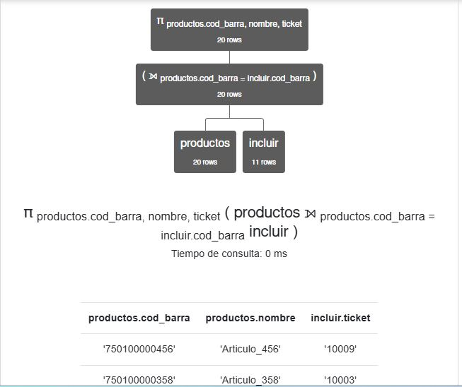
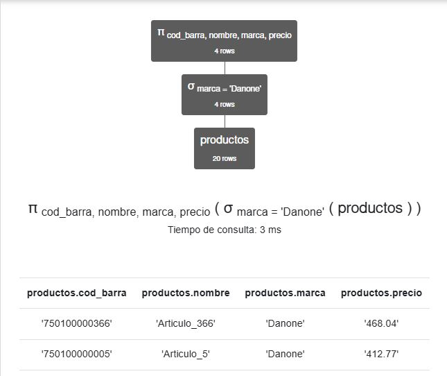
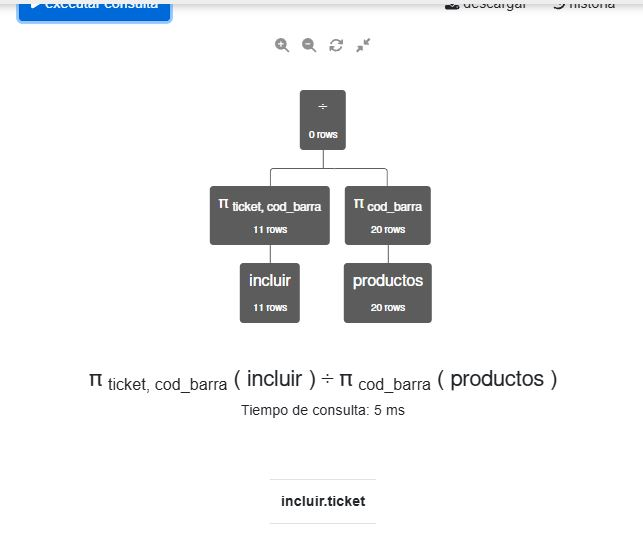

# Entrega Individual — Prácticas 6, 7 y 8 — Fiorella Piccolo

**Consulta 1 (LEFT OUTER JOIN):** Productos y tickets (incluyendo no vendidos).
Álgebra: `π productos.cod_barra, nombre, ticket (productos ⟕ productos.cod_barra = incluir.cod_barra incluir)`
SQL: `SELECT p.cod_barra, p.nombre, i.ticket FROM productos p LEFT OUTER JOIN incluir i ON p.cod_barra = i.cod_barra ORDER BY p.cod_barra;`

**Consulta 2 (Selección y proyección):** Productos de la marca `Danone`.
Álgebra: `π cod_barra, nombre, marca, precio (σ marca = 'Danone' (productos))`
SQL: `SELECT cod_barra, nombre, marca, precio FROM productos WHERE marca = 'Danone' ORDER BY precio DESC;`

**Consulta 3 (División relacional):** Tickets que incluyen todos los productos (`0 rows`, ningún ticket incluye todo el catálogo).
Álgebra: `π ticket, cod_barra (incluir) ÷ π cod_barra (productos)`
SQL: `SELECT DISTINCT i1.ticket FROM incluir i1 WHERE NOT EXISTS (SELECT p.cod_barra FROM productos p WHERE NOT EXISTS (SELECT 1 FROM incluir i2 WHERE i2.ticket = i1.ticket AND i2.cod_barra = p.cod_barra));`

